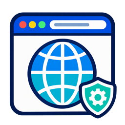

# Navegador de administración para Home Assistant



Complemento que permite abrir interfaces de administración de red
en Firefox remoto, accesible mediante Ingress. Versión 0.1.2, arquitectura amd64.

Incluye marcadores configurables, portapapeles de texto y transferencia de
archivos mediante una carpeta de intercambio. Todos los usuarios autorizados
comparten navegador y sesiones. Por defecto el perfil es temporal, las
contraseñas no se guardan y los archivos de intercambio se borran al arrancar.

## Instalación

Una vez publicado, añadir la URL de este repositorio a los repositorios de la
tienda de aplicaciones de Home Assistant e instalar «Navegador de administración».
La imagen se construye en HA; se necesitan acceso a Internet y espacio libre.

Mientras el repositorio sea privado, añadir su URL por sí sola no concede acceso
a HA. Utilizar la instalación local indicada abajo o configurar y verificar
expresamente la autenticación para el repositorio privado. No incluir credenciales
de acceso en archivos del proyecto.

Para instalación local, copiar `admin_browser` a `/addons/admin_browser_cfm`,
comprobar actualizaciones en la tienda e instalar el complemento local.

Configurar `admin_user_ids` con los ID de los administradores que podrán acceder.
La lista vacía bloquea el acceso. Añadir los marcadores en la configuración del
complemento, usando direcciones sin credenciales ni tokens.

Consultar [configuración y uso](admin_browser/DOCS.md),
[cambios](admin_browser/CHANGELOG.md) y [seguridad](SECURITY.md).

Pasar de la instalación local a una instalación desde repositorio crea otra
identidad de complemento en HA. No asumir que se migran automáticamente las
opciones o los perfiles; conservar la instalación anterior hasta verificar la
nueva. No publicar las opciones personales en Git.

## Desarrollo

Requiere Node.js 24 o posterior y Docker con contenedores Linux:

```text
npm ci
npm test
npm run test:docker
```

Las pruebas usan una red temporal `172.30.32.0/24`, necesaria para simular el
Supervisor y la puerta de acceso Ingress. Ejecutarlas en un Docker de pruebas
que no utilice ya esa red. No publicar puertos ni montar el socket de Docker
en el complemento. Los recursos temporales se eliminan al terminar salvo que
se indique `CFM_KEEP_TESTS=1` para depuración.

`CFM_HA_SECCOMP=1` solicita el modo de Docker observado con Supervisor. Docker
Desktop puede conservar otros filtros externos; la comprobación de aislamiento
en una instalación real sigue siendo necesaria.

Este repositorio contiene fuentes, dependencias fijadas, pruebas y documentación
genérica. Los resultados de pruebas, registros, informes de instalaciones,
credenciales, perfiles y copias de seguridad deben permanecer fuera de Git.
